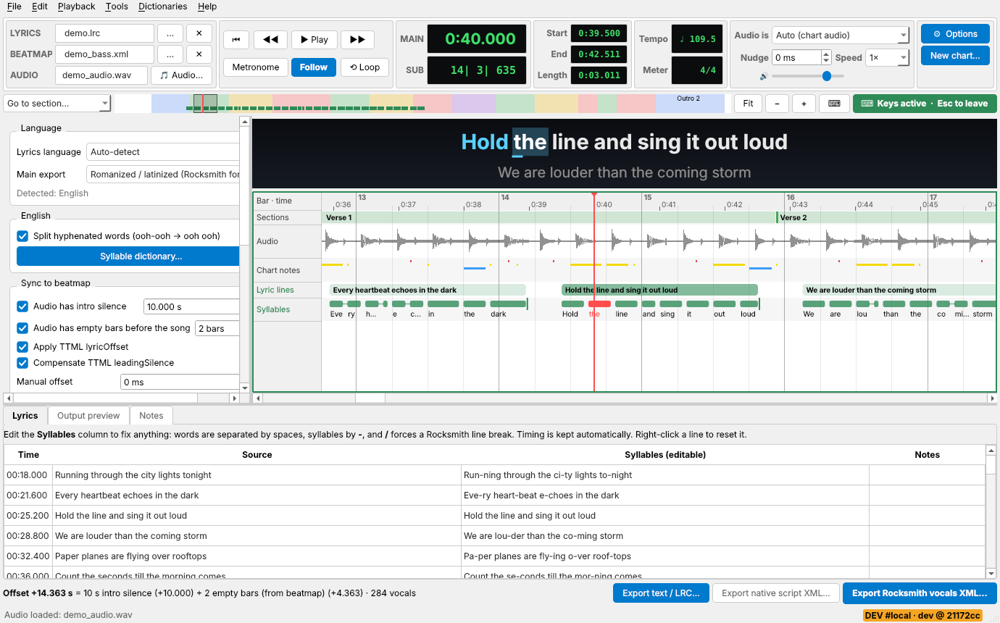
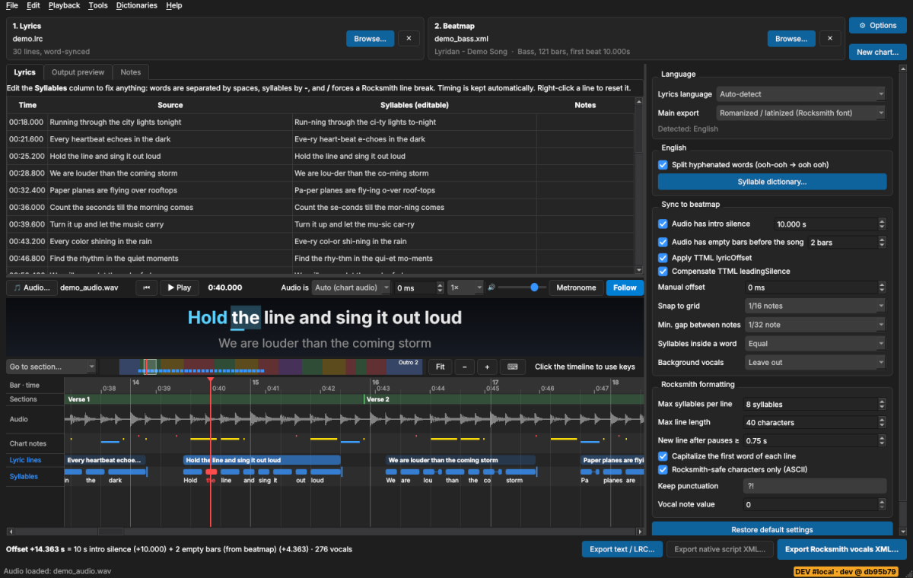
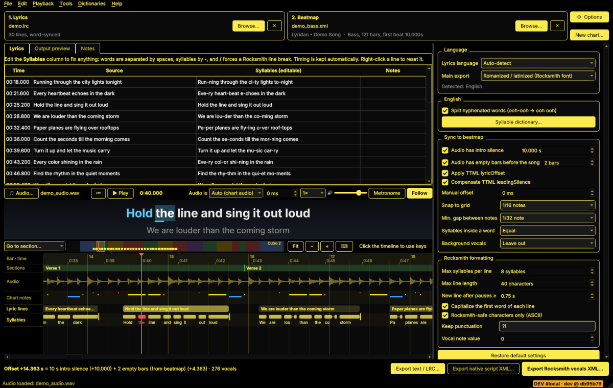
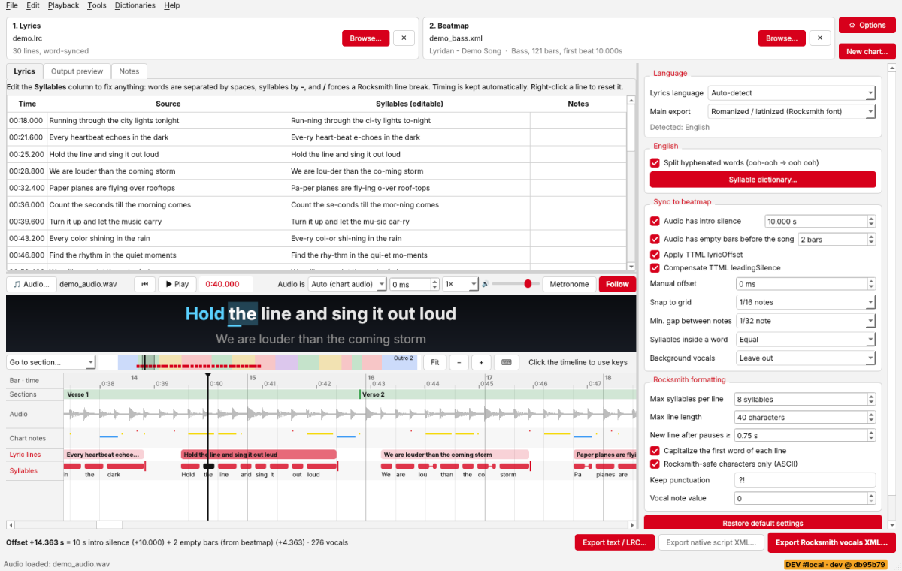
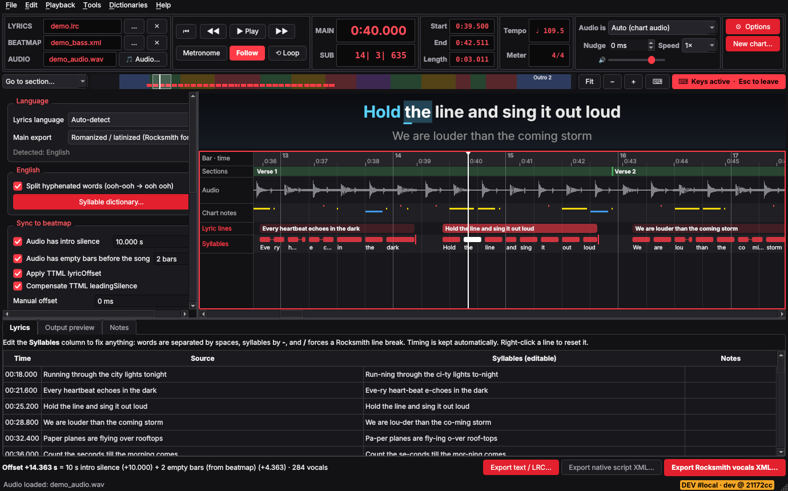
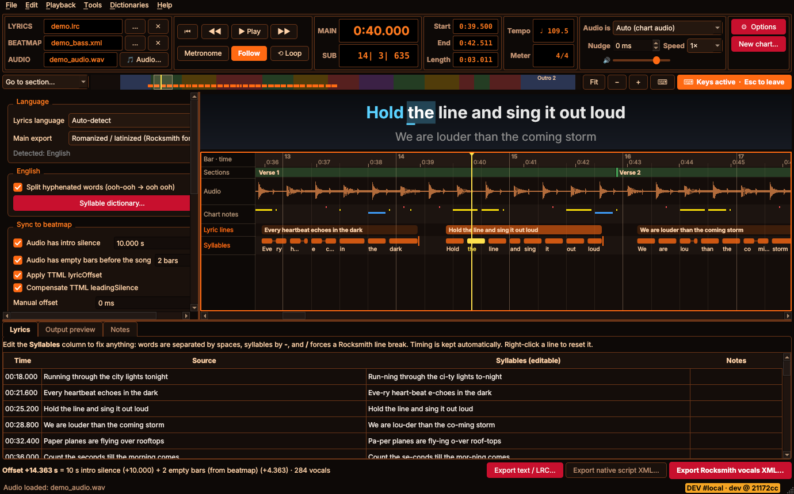
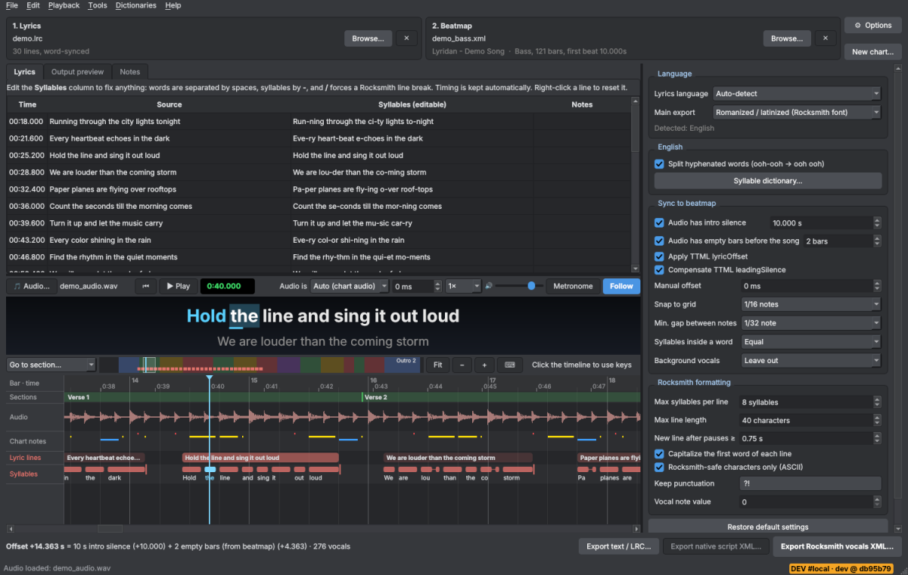
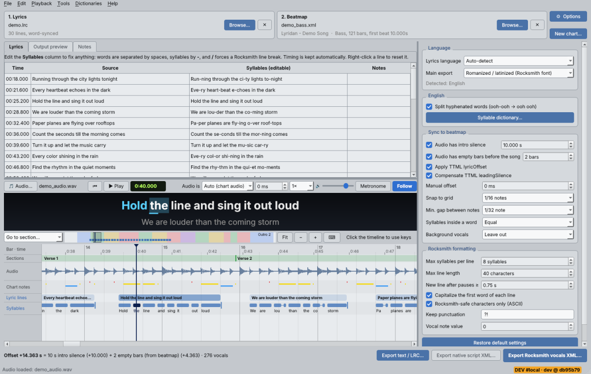
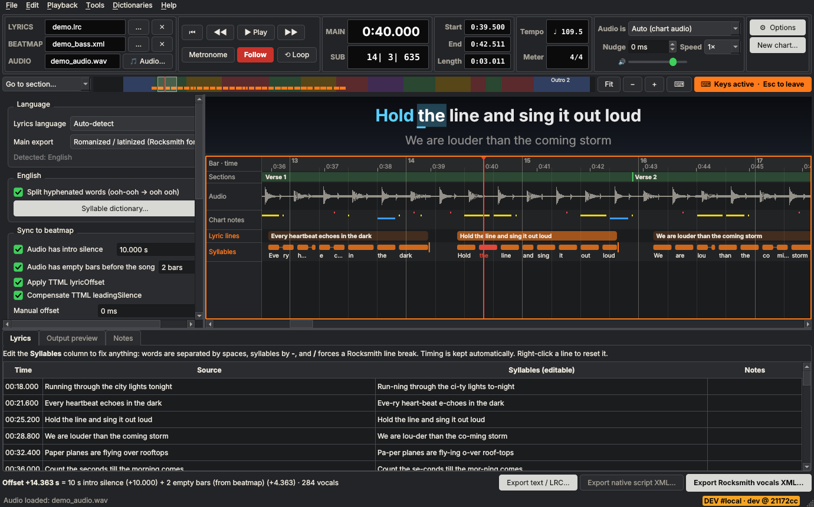
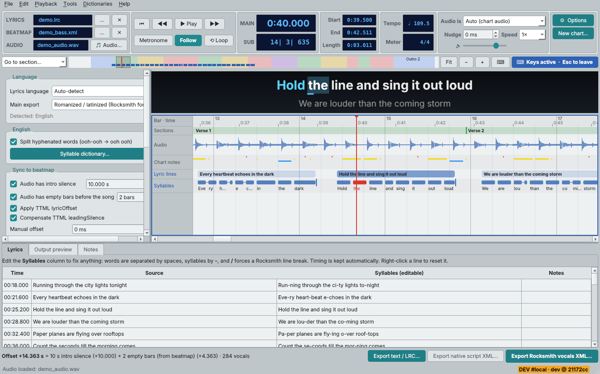

# Lyridan


Lyridan turns synced lyrics (`.ttml` or `.lrc`) into a **Rocksmith 2014 vocals arrangement XML**.
The output is already syllabized, romanized and snapped to your chart's beatmap, ready to import into
**Editor on Fire** or **Charter**, where you check and fine-tune it before it goes into your CDLC.

> Lyridan is a charting **assistant**, not a replacement for hand-made vocals. Always check the result
> by ear before publishing and abide by the Charting Guidelines.
>
> Lyridan is also **Claude-coded**. Elevatorisbest at no point claims that they are a coder/programmer, so please keep that in mind.
>
> Outside of code, generative AI was used strictly for made up lyrics in the Theme screenshots as well as formatting and information in this readme, which has been checked by the repo author. Elevatorisbest does **not** support or endorse generative AI outside of coding (hence the look of the logo, I made it on my own with my own hands).

**Contents:**
[Quick start](#quick-start) ·
[Features](#features) ·
[The window](#the-window) ·
[The timeline](#the-timeline) ·
[How sync works](#how-sync-works) ·
[Using .lrc files](#using-lrc-files) ·
[Language details](#language-details) ·
[Options and themes](#options-and-themes) ·
[Installation](#installation) ·
[Command line](#command-line) ·
[Building from source](#building-from-source) ·
[Credits and licenses](#credits-and-licenses)

---

## Quick start

1. **Lyrics:** drop a `.ttml` or `.lrc` file onto the window.
2. **Beatmap:** drop the arrangement XML of your chart (lead, rhythm or bass - it holds the synced beatmap).
3. **Audio:** drop the audio file your chart uses, or pick it with **🎵 Audio…** in the toolbar. It's used for playback and the timeline.
4. **Check:** play through the **timeline**, then look through the **Lyrics** tab underneath it (edit lines if needed) and the **Notes** tab.
5. **Export:** click **Export Rocksmith vocals XML…** and open it in EOF or Charter.
6. **Review:** play it against the song and fix any wrong syllables, line breaks or timing there. Only then build your CDLC (e.g. in DLC Builder) - don't drop the export straight into a finished CDLC.

Moving on to another song? **New chart…** (top right of the toolbar) clears the lyrics, beatmap, audio and your edits in one go.

- It always asks first, and **Cancel** is the default.
- The clear button only unlocks after a moment, so a reflex click or Enter can't wipe your work.
- Options and conversion settings are kept.

---

## Features

| | English | Japanese | Russian |
|---|---|---|---|
| Automatic syllables | ✅ dictionary + trained model | ✅ mora / syllable modes | ✅ phonetic or closed syllables |
| Romanization / latinization | — | ✅ Hepburn (configurable) | ✅ 7 standards |
| Native-script export | — | ✅ kana/kanji (JVocals) | ✅ Cyrillic |

### Inputs
- Apple Music **syllable-synced TTML** (raw TTML or the JSON API response) - the most accurate source.
- Word- or line-synced TTML.
- Plain **LRC** and enhanced LRC (`<mm:ss.xx>` word tags). These work well once aligned to the song audio, see [Using .lrc files](#using-lrc-files).

Apple's own syllable splits are kept: if the TTML splits a word (`para` + `dise`), those splits are used and timed exactly.

### Beat sync
- Load any arrangement XML from your chart. Every syllable is snapped to its beat grid: 1/4 to 1/64 notes, triplets included, time-signature aware.
- Charting guidelines are toggles: the offset for your audio's **intro silence** (10 s by default) and **two empty bars** (measured from your beatmap).
- Lyridan warns if a lyric would land inside the intro silence or the empty bars.

### Rocksmith formatting
- `-` / `+` markup.
- The first word of each line is capitalized.
- Punctuation is cleaned up.
- Characters are ASCII-safe for the stock font.

### Phrase-aware line breaks
Lines are kept to about **7-8 sung syllables** (the usual charting rule of thumb; Japanese gets a little more). Every way of breaking a phrase is compared at once:

- commas and real pauses are preferred break points
- words that belong together stay together: articles and prepositions with their noun, Russian "не" with its verb, Japanese particles with their word
- tiny fragments are avoided: "Ya / zhdu otveta" becomes "Ya zhdu otveta"
- a line one or two syllables over the limit is kept whole when splitting it would read worse

### Editing, projects and exports
- **Edit any line** in the editor (`Eve-ry mo-ment / Takes me to pa-ra-dise`). The timing is kept and `/` forces a line break.
- **Projects** (`.lyridan`) save the lyrics, beatmap, audio, settings and your edits.
- **User dictionaries** hold your own English syllable splits and Japanese readings.
- **Other exports:** syllabized text (for UltraStar Creator and similar) and romanized LRC or enhanced LRC.

---

## The window

The window is laid out like a DAW edit window. From top to bottom:

- **Toolbar**, in groups:
  - **Session:** the loaded lyrics, beatmap and audio files. **…** opens a file, **✕** removes it, and hovering a name shows its details (line count, arrangement, bars, first beat…).
  - **Transport:** back to the first lyric, previous / next lyric line (**◀◀ ▶▶**), **Play**, **Metronome**, **Follow** and **Loop**.
  - **MAIN** counter (chart time, as in the exported XML) and **SUB** counter (bar | beat | tick at the playhead).
  - **Start / End / Length** of the play range, see [Play range and loop](#play-range-and-loop).
  - **Tempo / Meter** of your chart's beatmap at the playhead.
  - **Playback:** chart audio or original song, preview nudge, speed and volume.
  - **⚙ Options** and **New chart…**
- **Overview strip:** go to a section, the whole song at a glance, zoom and the keyboard help (⌨).
- **Settings** on the left and the **timeline** with the in-game lyrics preview in the middle.
- **Lyrics / Output preview / Notes** tabs underneath.
- **Export** buttons and the offset breakdown at the bottom.

The counters and file displays use the theme's clock colours (green on black unless the theme has its own). Drag the dividers to give the timeline or the lyrics more room.

---

## The timeline

The timeline comes with playback and an **in-game lyrics preview**. Press **Play** (Space / Ctrl+P) and the preview shows each line the way Rocksmith will: syllables light up as they're sung and the next line waits below. It is built from the exact vocals that will be exported, so you can check the final sync and line breaks before exporting.

The timeline rows, top to bottom (the Digital Studio themes draw them as DAW rulers and tracks, with the names in brackets):

| Row | Shows |
|---|---|
| Bar · time (Bars\|Beats, Min:Secs) | measure numbers and time |
| Sections (Markers) | coloured, named sections from your chart (Verse 1, Chorus 2…) |
| Audio | the song's waveform (a clip named after the audio file) |
| Chart notes | your chart's notes, one lane per string |
| Lyric lines (Vocals) | each Rocksmith line as one block with its full text |
| Syllables | one bar per syllable, joined within a word, with a mark at every line break |
| Reference rows | optional: an existing vocals XML to compare against (**File → Compare with existing vocals XML…**), e.g. when redoing a chart that already has vocals |

### Getting around
- **Overview strip:** the whole song at a glance. Click or drag it to view any part.
- **Go to section…** jumps straight to a section; **Fit** shows the whole song.
- **◀◀ ▶▶** in the toolbar jump to the previous / next lyric line.
- **Mouse:**
  - click to move the playhead (drag to scrub)
  - click a section to jump to it
  - double-click a lyric line to play it
  - Shift + drag to select a play range, Shift + click to clear it
  - wheel to scroll (Shift = faster), Ctrl + wheel to zoom
  - right/middle-drag to pan

### Play range and loop
The **Start / End / Length** clocks show the lyric line under the playhead, or a range you select with **Shift + drag** in the timeline. A selected range is highlighted across the tracks, and the three clocks get a coloured frame while they show it.

- Click **Start** or **End** to jump there.
- Click **Length** to play the range once; playback stops at its end.
- **⟲ Loop** (or **L** in the timeline) repeats the range while playing. Without a selected range it repeats the line under the playhead, which is handy for checking one line's timing over and over.
- Jumping past the end of the loop with the keyboard or mouse isn't pulled back, so you can still move around freely.

### Keyboard
The timeline keys work while the timeline has the keyboard. A coloured frame and a **Keys active** label show it is listening. To give it the keyboard, click:

- the timeline itself;
- the lyrics preview or the overview strip;
- the transport and zoom buttons;
- the MAIN or SUB counter, or the Start / End / Length clocks.

Everything except the timeline itself can be switched off in Options. This works the same while playing or paused. **Esc** hands the keyboard back, and **Tab** never moves it into the settings, so these keys can't change anything outside the timeline. The ⌨ button lists them too.

| Key | Action |
|---|---|
| ← → | step the playhead (1/4 beat … 1 bar, set in Options; speeds up while held) |
| Shift + ← → | 4× bigger steps |
| Ctrl/Alt + ← → | previous / next lyric line |
| PgUp / PgDn | previous / next section |
| Home / End | start / end of the song |
| ↑ ↓ | zoom in / out |
| Space · Enter | play / pause · play the current line |
| F | fit the whole song |
| L | loop on / off |

### Audio
- **Pick the audio** your chart uses with **🎵 Audio…** or drop it on the window.
- **A new chart gets fresh audio:** loading a *different* chart XML unloads the previous chart's audio, so you never preview against the wrong song.
- **Chart audio or the original song:** both work. Lyridan detects which one you loaded and shifts the original song by the intro silence and empty bars.
- **Controls:** metronome on the chart's beats, 0.5× / 0.75× speed, follow-playhead and loop.

### No accidental changes
- The mouse wheel over a number box, drop-down or slider in the settings **scrolls the panel** instead of changing the value, unless you clicked into that field first.
- Toolbar buttons never keep the keyboard, and the toolbar drop-downs and nudge box hand it back to the timeline once you've used them, so arrow keys can't change them by accident.
- Tab can't move the keyboard from the timeline into the settings, and typing while the timeline has the keyboard changes nothing.

---

## How sync works

```
chart time = lyric time
           + intro silence            (default 10 s)                 [toggle]
           + N empty bars             (read from your beatmap)       [toggle]
           + TTML lyricOffset         (Apple, e.g. -0.139 s)          [toggle]
           - TTML leadingSilence      (Apple, e.g. 0.200 s)           [toggle]
           + manual offset (ms)
```

The total is shown at the bottom of the window. As an example, we checked this on *Baby Be Mine* against a hand-made vocal track from Elevatorisbest's (author of this repo) Rocksmith chart of the song. With the defaults it got an offset of +14.024 s, and compared with the hand-made vocals:

- 405 of 416 syllables are identical.
- The median timing difference is 0.000 s.
- 86% of syllables land within 150 ms.
- The first lyric is on the exact same 1/16 grid point.

If your chart's audio was prepared differently, turn off the toggles that don't apply and use the manual offset. The timeline shows the result against your chart notes.

---

## Using .lrc files

A normal `.lrc` file only says when each **line** starts. On its own, Lyridan can only estimate the syllable timing inside a line. **Aligning it to the song audio fixes most of that.** A syllable-synced `.ttml` (e.g. from Apple Music) is still the most accurate source, so use one when it exists for your song.

How this looked when we tried it on *Baby Be Mine*, compared with the hand-made vocal track of our own chart:

| Input | Same 1/16 grid point | Within a 1/16 note | Median difference |
|---|---|---|---|
| Apple syllable `.ttml` | 175 / 405 | 93% | 68 ms |
| plain `.lrc`, estimated | 3 / 405 | 3% | 818 ms |
| plain `.lrc` + audio alignment | 230 / 405 | 84% | 1 ms |

### Align an .lrc to the song audio
When an `.lrc` is loaded, the Lyrics tab shows a short note with an **Align to song audio…** button (also in **Tools**):

1. **Choose the song audio:** your chart's audio or the original song. Optionally, but recommended, add an isolated **vocal stem** of that same audio (UVR5, Demucs…). Lyridan listens to the stem while the timeline keeps playing the full song.
2. **Lyridan listens:** it finds where the lyrics start (it recognises a chart's intro silence + empty bars automatically). Then Meta's multilingual **MMS forced-alignment** speech model, run locally, finds where every syllable is sung, with the `.lrc` line timestamps as anchors. Parenthesised backing vocals become background lines.
3. **Keep the result:** it is saved as a normal syllable-synced `.ttml` you can keep, fix and reuse.

**What to expect:**
- Results vary from song to song. Dense backing vocals, heavy effects, very fast or very long notes and overlapping singers are harder.
- Lines the model can barely hear are listed as **hard to hear**. They lean on their `.lrc` timestamps instead of being squeezed into the wrong place - check them first.
- **A vocal stem helps most exactly there.** In our tests on *Ghost Sequence* (a Japanese song), the full mix gave almost no usable signal for one heavily layered English line, while a UVR5 stem placed it correctly. On *Baby Be Mine*, a stem cut the syllables that were off by more than half a second from 45 to 29 (of 419).
- A full song takes about 30-60 s on a modern CPU and ~1.5 GB of RAM.

**Japanese kanji readings are checked against the audio too.** Some kanji have several readings, and songs often use a less common one (緋 is normally read *hi*, but some songs sing it *aka*).
- A reading that clearly wins replaces the dictionary one.
- Close calls are only listed for you to check by ear.
- Turn it off in the alignment dialog or with `--no-verify-readings`.
- Without audio, readings stay dictionary-based. Write `{緋|あか}` in the lyrics to force a reading.

**The model** (~340 MB) is **downloaded on first use** after you accept its licence (see [Credits and licenses](#credits-and-licenses)). It can be removed again from the Tools menu.

---

## Language details

### English
Syllables come from, in order:
1. your own dictionary
2. built-in lyric words (gonna, c'mon, everybody…)
3. a curated 47,700-word karaoke-style syllable dictionary (*li-ving, ma-gic, eve-ry, dif-fe-rent*)
4. for any other word, a boundary model trained on that dictionary and guided by CMU Pronouncing Dictionary syllable counts (it splits about 95% of unseen words exactly like the dictionary would)

Contractions, possessives, elongated words (*ooooh*) and hyphenated words are handled.

### Japanese
**Readings**
- Readings come from MeCab (fugashi) with UniDic, so they depend on context.
- **Lyric corrections:** 私→watashi, 明日→ashita, 貴女→anata, 抱く→daku (or *idaku* after 夢を), 何を→nani o…
- **Reading review:** words songs often read differently (宇宙 *sora*, 永遠 *towa*, 運命 *sadame*, 刃 *yaiba*…) are listed in the Notes column.
- **Furigana in the lyric file wins:** `宇宙(そら)`, `宇宙（そら）`, `{宇宙|そら}`, `|宇宙《そら》`. The reading dictionary in the app does the same for every song.

**Romanization** (modified Hepburn)
- は/へ/を are spelled as pronounced, also inside words (こんにちは → *konnichiwa*).
- っ doubles the consonant; *tch* before *ch*.
- Options: long vowels as written (*tou*), macrons (*tō*) or simplified (*to*) · を as *o* or *wo* · *n'* before vowels · katakana loanwords in English (ラブ → *love*).
- If the TTML includes Apple's own romaji (`ja-Latn`), Lyridan can use it directly.

**Syllables and words**
- Verbs keep their endings (*dakishimetai, utatte*), particles stay separate (*kimi no*), English words stay English.
- Modes: every mora, mora with ん/っ joined (default: *kon-ni-chi-wa*), or syllables with long vowels joined (*tou-kyou*).
- **Native-script export:** every romaji syllable remembers its kana/kanji, so a Japanese vocals XML (for a custom font in DLC Builder) can be exported with the same timing.

### Russian
- **ё restoration** (еще → ещё, идет → идёт), from a 120,000-word-form list built from OpenCorpora; only where the spelling is unambiguous.
- **Syllables:** phonetic and open (*ко-шка, се-стра, кар-та, сол-нце*) or closed (*кош-ка*).
- **Latinization:** Practical (Wikipedia/English), BGN/PCGN, GOST 7.79-B, ISO 9, ICAO (passports), ALA-LC and Scholarly. Context rules (*ye* after vowels, *-sky* endings…) are applied per word, then split by syllable.

---

## Options and themes

Open them with the **⚙ Options** button at the right end of the toolbar (or Edit → Options):

- **Themes and text sizes**
- **Playback defaults**, the **timeline arrow-key step** and whether clicking the preview, overview, transport buttons or clocks gives the timeline the keyboard
- **Reopening the last session** and the **default export folder**
- **Notices:** the export disclaimer and resetting dismissed notices
- **Alignment model management** and **About this build**

| Theme | Look |
|---|---|
| System | follows your operating system |
| Light | neutral light |
| Dark | neutral dark |
| Lyridan Dark | black and yellow, the original look from v1.x |
| Running Red | light, white and red |
| Akai Dark | dark with red accents |
| Mechanical Red & Orange | dark, black with orange and red |
| Digital Studio | **default**; dark, inspired by a DAW edit window: rulers, markers, clips and track headers in the timeline, green counters |
| Digital Studio Light | light version of Digital Studio, inspired by a classic DAW edit window |
| Studio Console | dark, inspired by an analogue mixing console strip |
| Studio Console Light | light, inspired by a different analogue console strip |

<details>
<summary><b>Theme screenshots</b> (click to expand)</summary>

*The screenshots show the timeline holding the keyboard at 0:40 in a demo song. They use made-up demo lyrics by Claude only to avoid putting too much of real songs in the repo. Elevatorisbest is against generative AI usage and this does not constitute support or endorsement of such stuff.*

**Light**



**Dark**



**Lyridan Dark**



**Running Red**



**Akai Dark**



**Mechanical Red & Orange**



**Digital Studio**



**Digital Studio Light**



**Studio Console**



**Studio Console Light**



</details>

In every theme a check box that is **on** shows a tick on the accent colour, and one that is **off** is an empty outlined box.

---

## Installation

### Windows
Download `Lyridan-<version>-Windows-x64-Setup.exe` from Releases and run it. A portable `.zip` is also provided.

> SmartScreen may warn because the app isn't code-signed. Choose **More info → Run anyway**.

### macOS (Apple Silicon and Intel)
Download the DMG for your Mac (`AppleSilicon` or `Intel`), open it and drag Lyridan to Applications.

> The app isn't notarized. If macOS says it's damaged or from an unidentified developer, run:
> ```bash
> xattr -cr /Applications/Lyridan.app
> ```

### Updates
Lyridan checks for a newer build each time it starts (Windows installer, Windows portable zip and macOS app in Applications).
- By default the update downloads in the background and installs the **next time you start Lyridan**: the app closes, updates itself and opens again. A bar at the top of the window says when one is ready (**Restart and update now** installs it right away).
- Turn off *Download updates in the background…* in **Edit → Options → Updates** to be asked first (**Update now / What's new / Skip this build**). **Help → Check for updates…** checks by hand.
- **Update from branch:** *Automatic* follows the branch your build came from (stable builds follow `main`). You can pick any other branch that has builds (the old `v1.1.1` branch isn't offered). Switching installs that branch's newest build, even if it's older.
- If an update fails it isn't retried automatically, and a build you installed yourself that is older than the newest one is never replaced without asking.
- Running a downloaded `Setup.exe` over an existing install (older or newer) updates it in place. It uses the same folder, asks you to close a running Lyridan, and replaces the old program files completely. Settings are kept.

---

## Command line

Works with the installed app too:

```bash
python -m lyridan convert song.ttml -b "2_Bass_RS2.xml" -o "1_Vocals_RS2.xml" [--native-output JVocals.xml]
python -m lyridan text song.lrc                               # print syllabized / romanized lyrics
python -m lyridan align song.lrc song.ogg -b chart.xml --yes  # .lrc -> syllable .ttml using the audio
python -m lyridan convert --help                              # all options
```

---

## Building from source

Requires Python 3.11+.

```bash
pip install -r requirements-dev.txt
python -m pytest -q          # tests
python Lyridan.py            # run the app
```

- **Windows installer:** `build_windows.bat` (needs Inno Setup 6 for the installer step).
- **macOS app + DMG:** `bash build_macos.sh` (builds for the architecture of the Mac it runs on).

### CI and release channels
Every push runs the tests, then `.github/workflows/build.yml` builds:
- **Windows:** installer + portable zip
- **macOS Apple Silicon** (`macos-15`) and **Intel** (`macos-15-intel`): `.pkg` installer + `.dmg`

Each frozen app is smoke-tested before packaging.

Every branch except `v1.1.1` is built on push. `main` / `v*` tags publish `v<VERSION>` (the "latest" release), `dev` publishes the rolling `dev-latest` pre-release and every other branch publishes `<branch>-latest`. Each release carries an `update.json` manifest (version, commit, CI run number, SHA-256 of every installer) that the auto-updater reads (`lyridan/updater.py`, `lyridan/update_channels.py`, `tools/make_update_manifest.py`). Deleting a branch removes its rolling release (`cleanup-branch-builds.yml`, which runs from `main`).

| Push to | Channel | Version shown | Published as |
|---|---|---|---|
| `dev` | dev | `2.0.0-dev.<run> (<commit>)` + DEV badge | rolling pre-release **dev-latest** + workflow artifacts |
| any other branch (not `v1.1.1`) | dev | same as `dev` | rolling pre-release **&lt;branch&gt;-latest** + workflow artifacts |
| `main` | stable | `2.0.0` | GitHub release **v2.0.0** |
| tag `v*` | stable | `2.0.0` | release for that tag |

- **Dev builds** show full build info in **Options → About this build**: branch, commit, message, build number, build machine, workflow run link and library versions, with a "Copy build info" button.
- **New release:** bump `VERSION` in `lyridan/__init__.py` before merging to `main`. If `VERSION` wasn't bumped, the files of the existing release are re-uploaded.
- **Local builds** are dev builds unless you pass `--channel stable`.
- `python -m lyridan --version` prints the same build info.

### Language data
The bundled language data can be rebuilt with the scripts in `tools/`:

| Script | Rebuilds |
|---|---|
| `train_english_model.py --eval` | English boundary model |
| `build_cmu_counts.py` | CMU syllable counts |
| `build_yo_dict.py` | ё dictionary |
| `compare_reference.py -v` | compares output with a hand-made vocal track (test files) |

### Project layout
```
lyridan/
  parsers/   ttml.py, lrc.py, rsxml.py     input files, beatmap, vocals XML
  lang/      english.py, japanese.py, kana.py, russian.py, hyphen_model.py
  align/     audio alignment (MMS model, readings check)
  pipeline.py    language processing + timing of every syllable
  rocksmith.py   offsets, grid snapping, line breaking, Rocksmith markup
  gui/           PySide6 interface
  data/          dictionaries and models
packaging/   PyInstaller spec, Inno Setup script, DMG script
tests/       regression tests and the files they use
```

---

## Credits and licenses

Lyridan is **GPL-2.0**. It uses:

- PySide6 / Qt (LGPL)
- fugashi (MIT) and MeCab (BSD)
- UniDic-lite (BSD)
- the CMU Pronouncing Dictionary (BSD)
- ONNX Runtime (MIT), NumPy (BSD), soundfile / libsndfile (BSD / LGPL), python-soxr (LGPL), certifi (MPL-2.0)
- OpenCorpora data via pymorphy3 (CC BY-SA, ё list)

### Alignment model
The optional alignment model is **not** part of Lyridan's code or installers. It is downloaded separately on first use.

- **Model:** the MMS forced aligner by Meta AI (V. Pratap et al., [*Scaling Speech Technology to 1,000+ Languages*](https://arxiv.org/abs/2305.13516), 2023), distributed through [torchaudio](https://docs.pytorch.org/audio/main/generated/torchaudio.pipelines.MMS_FA.html).
- **Licence:** [CC BY-NC 4.0](https://creativecommons.org/licenses/by-nc/4.0/), **non-commercial use only**. That fits Lyridan, a free charting tool; it must not be used commercially.
- **Changes:** exported to ONNX and quantized to 8-bit by the Lyridan project (`tools/export_alignment_model.py`).
- **Hosting:** published with this attribution as the `alignment-model-v1` release by `.github/workflows/alignment-model.yml`.
- **Scope:** the model's licence covers the model files only. Lyridan's source code stays GPL-2.0.

Made by Elevatorisbest.
